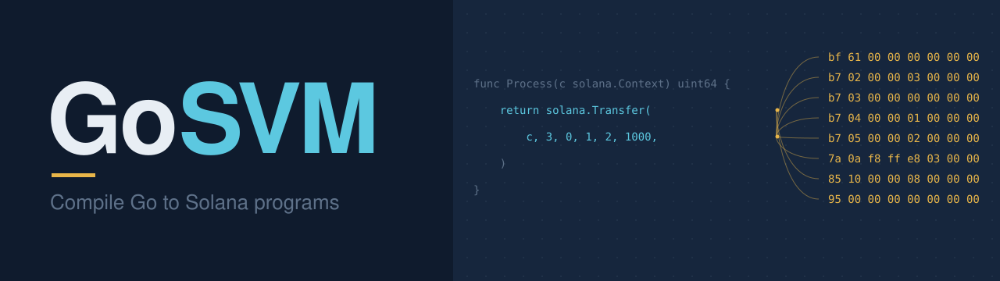

**Write Solana and Fogo programs in Go.**

goSVM compiles ordinary Go into SVM programs for Solana and Fogo, with generated
account validation, clients, and native Go tests. Share types and business logic
between your on-chain program and an ordinary Go backend. The compiled program
runs without a Go runtime, garbage collector, or scheduler.

> **Public alpha.** goSVM is experimental and unaudited. Use it on devnets and
> testnets; it is not yet recommended for production funds.

```go
import (
	"github.com/KyberNetwork/uniswapv3-sdk-uint256/utils"
	"github.com/holiman/uint256"
)

// Unmodified upstream Go libraries, compiled to SBF.
func priceAt(tick int) (*uint256.Int, error) {
	var r utils.Uint160
	err := utils.GetSqrtRatioAtTickV2(tick, &r)
	return &r, err
}
```

## Why goSVM?

- **Real Go, Go's results.** Generics, interfaces, closures, maps, strings,
  `defer`, `panic`, package variables and a useful slice of the standard library.
  Every feature is tested differentially against native Go and executed on the
  SVM for both Fogo and Solana.
- **Use existing Go libraries.** Published modules work as ordinary `go.mod`
  dependencies. `holiman/uint256` and the Uniswap v3 tick and swap math run on
  chain unmodified and match native Go on tens of thousands of inputs.
- **A short edit–build–test loop.** Small applications rebuild in under a second.
  Test business logic with Go tooling, then run the compiled program in a local
  SVM runtime.
- **One set of Go types and calculations.** On-chain programs and off-chain
  services import the same packages; your backend keeps the whole Go ecosystem.
- **Generated account plumbing.** Declare instructions and accounts; goSVM
  generates owner, signer, writable, PDA and relationship checks, wire codecs,
  Go clients and an experimental IDL.
- **Real Solana integration.** SPL Token transfers, signed CPIs, Clock and Rent,
  account creation and closing, return data, and Keccak-256 hashing.

## What does it cost?

Compute units per call on chain (fogo-v0; solana-v3 within about 1.5%), using the
unmodified libraries
([evidence](results/compiler/2026-10-16-real-libraries/README.md),
[after compile-time initialization](results/compiler/2026-10-16-const-init/README.md)):

| Operation | CU |
| --- | ---: |
| `uint256` Add / Mul | 35 / 376 |
| `uint256` Div (256-bit by 192-bit, Knuth) | 1,368 |
| Uniswap v3 `GetSqrtRatioAtTickV2` | 2,447–5,252 |
| Uniswap v3 `GetTickAtSqrtRatioV2` | 8,014–13,951 |
| Uniswap v3 `ComputeSwapStep`, whole transaction | 18,439 |

A separate optimized port of the Whirlpools swap handler uses about **1.28×
Rust's compute units** (median paired ratio over 166 scenarios against scoped
and full upstream Rust, on the historical v1.51 backend). It is a scoped port,
not the complete contract. [Benchmark scope and evidence](docs/WHIRLPOOLS_133_TARGET.md).

## Try it

Release binaries run on **macOS arm64**, **Linux x86_64** and **Linux arm64**. The
installer checks the download's SHA-256; `gosvm toolchain install` then fetches
Anza's official Solana platform-tools (a one-time 430–530 MB download, ~210 MB
kept) and goSVM's SVM test runners, each verified against pins built into the CLI.
One project builds for both Fogo and Solana; goSVM picks the instruction set,
pinned compiler backend and test runtime for each network. `gosvm test` runs your
Go tests, so install [Go](https://go.dev/dl/) too (1.23 or newer on macOS 26). Building Go programs does not
require Cargo or Rust.

```sh
curl -fsSL https://github.com/CrocSwap/goSVM/releases/download/v0.1.0-alpha.3/install-release.sh | sh
export PATH="$HOME/.local/bin:$PATH"

gosvm toolchain install   # Download the pinned backend and SVM test runners
gosvm doctor
gosvm new my-swap         # Targets fogo and solana
cd my-swap

gosvm check               # Check the supported Go subset
gosvm test                # Run native Go tests
gosvm build               # build/fogo/program.so and build/solana/program.so
gosvm test --svm          # Run the compiled program in a local SVM runtime
gosvm deploy -network solana-devnet -check   # Confirm the cluster accepts it
```

The starter is a small arithmetic-only swap, with generated bindings and tests.
Edit `program.go` and rebuild. For multi-account applications, explore the
[token swap](examples/full-swap/README.md) and [escrow](examples/escrow/README.md),
or scaffold with `gosvm new -schema 2 -sdk 2 my-program`.

**Next:** [the tutorial](docs/TUTORIAL.md) builds a program with accounts, tests
it, deploys it to Solana devnet and calls it from Go.

`gosvm test --svm` runs the compiled program for every target in a local SVM
runtime, choosing the matching managed runner, which `gosvm toolchain install`
downloads and verifies against pins built into the CLI; add
`-target solana -elf other.so` to test an ELF from another backend. `gosvm deploy`
reads the cluster's live feature gates before deploying with a dedicated
per-network payer, and `gosvm call Increment -amount 3` simulates or sends an instruction by name,
resolving its accounts from the schema.
Pure [Bend libraries](docs/BEND_LIBRARIES.md) join a program with
`gosvm library add`, from published manifests or built from a `.bend` source
(`-bend-source PROOF.bend -root ns.fn`); [Rust crates](docs/RUST_LIBRARIES.md)
with `-rust`. [Targets, deployment and migration](docs/TARGET_PROFILES.md)
cover the details. To build the CLI from source instead (Go 1.22 and host Clang),
clone the repository and run `bash scripts/install.sh "$HOME/.local/bin"`; see
[installation details](docs/DEVELOPMENT.md#start-a-go-project) and the
[releases](https://github.com/CrocSwap/goSVM/releases).

## Share code with your backend

The [ordinary Go service](examples/full-swap-service/README.md) imports the swap's
actual types, quote calculation, and generated client:

```go
args := model.SwapArgs{AmountIn: amount, MinOut: minimum}
quote := model.Quote(reserveX, reserveY, args.AmountIn)
instruction := client.EncodeInstructionSwap(args)
```

Only packages reachable from the on-chain entrypoint need to follow the compiler's
Go subset. The service can use HTTP, JSON, databases, and other ordinary Go
facilities in its own code, without installing the compiler or SBF tools.

## What Go is supported?

| Area | Supported on chain |
| --- | --- |
| Types | Every integer type with Go's wrapping and division semantics ([integers](docs/GO_INTEGERS.md)), `bool`, structs with `==`, type aliases ([types](docs/GO_TYPES.md)), [arrays](docs/GO_ARRAYS.md) of any element type, pointers, slices, [strings and `error`](docs/GO_STRINGS.md), [maps](docs/GO_MAPS.md) |
| Abstraction | Methods, [interfaces](docs/GO_INTERFACES.md) (dynamic dispatch, type assertions and switches), [generics](docs/GO_GENERICS.md), [function values, closures and `defer`](docs/GO_FUNCTIONS.md), [variadic functions](docs/GO_FUNCTIONS.md#variadic-functions) |
| Control | `if`, `for`, expression and type `switch`, `range` over integers, slices, arrays and strings, unlabeled `break`/`continue`, `defer`, `panic` (a logged abort) |
| Memory | Bounded [heap allocation](docs/GO_ALLOCATION.md) (`new`, `make`, `append`, Go's growth rule), escape analysis |
| Packages | User packages and published modules, [package variables and `init`](docs/GO_GLOBALS.md) (fully determined initialization is evaluated at compile time), opt-in [trimming](docs/GO_PACKAGES.md#trimming) of unused library code |
| Standard library | [`errors`, `strings`, `bytes`, `strconv` (integers), `encoding/binary`, `unicode/utf8`, `unicode`, `math` (integer limits), `io`](docs/GO_STDLIB.md) and [`math/bits`](docs/GO_BITS.md), compiled from Go 1.22's own source |

Evaluation order, traps and heap accounting follow the Go 1.22 compiler and are
written down in the [runtime contract](docs/ERROR_CONTRACT.md).

**Not supported:** floats, goroutines and channels, `recover`, labels, `goto` and `fallthrough`, `range` over maps
(Go randomizes its order), recursion, garbage collection, and other
standard-library packages such as `fmt`, `math/big` and `reflect`. Unsupported
code is rejected at compile time with a source-located error, never miscompiled
silently. [Language details](docs/DEVELOPMENT.md#supported-subset-and-remaining-blockers).

goSVM lowers Go through checked C and Solana's Clang/LLD to SBF: SBPFv0 for Fogo
and SBPFv3 for Solana ([target profiles](docs/TARGET_PROFILES.md)).

## Explore

- **Start here:** [first-program tutorial](docs/TUTORIAL.md).
- **Examples:** [bounded starter](examples/typed-swap/README.md),
  [token-swap lifecycle](examples/full-swap/README.md),
  [SOL escrow](examples/escrow/README.md), [Go backend](examples/full-swap-service/README.md),
  [real Go libraries on chain](examples/real-libraries/README.md).
- **Build applications:** [multi-account schema](docs/SCHEMA2.md),
  [SDK](docs/SDK2.md), [target profiles](docs/TARGET_PROFILES.md),
  [Go packages and modules](docs/GO_PACKAGES.md), [Bend libraries](docs/BEND_LIBRARIES.md),
  [Rust libraries](docs/RUST_LIBRARIES.md), [SVM test fixtures](docs/SVM_FIXTURES.md).
- **Follow development:** [roadmap](ROADMAP.md).
- **Work on goSVM:** [agent orientation](AGENTS.md), [current handoff](HANDOFF.md),
  [development and benchmark reference](docs/DEVELOPMENT.md).

## License

goSVM is licensed under the [Apache License 2.0](LICENSE). Third-party
components keep their own licenses; see [NOTICE](NOTICE) and
[THIRD_PARTY_NOTICES](THIRD_PARTY_NOTICES).
